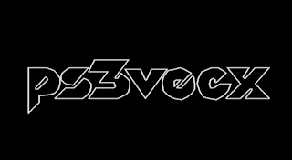
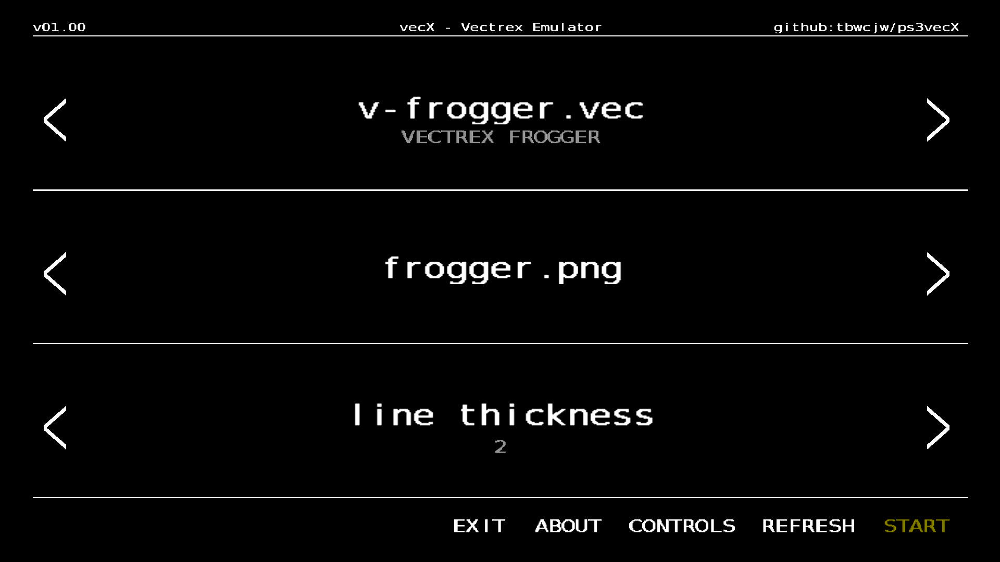
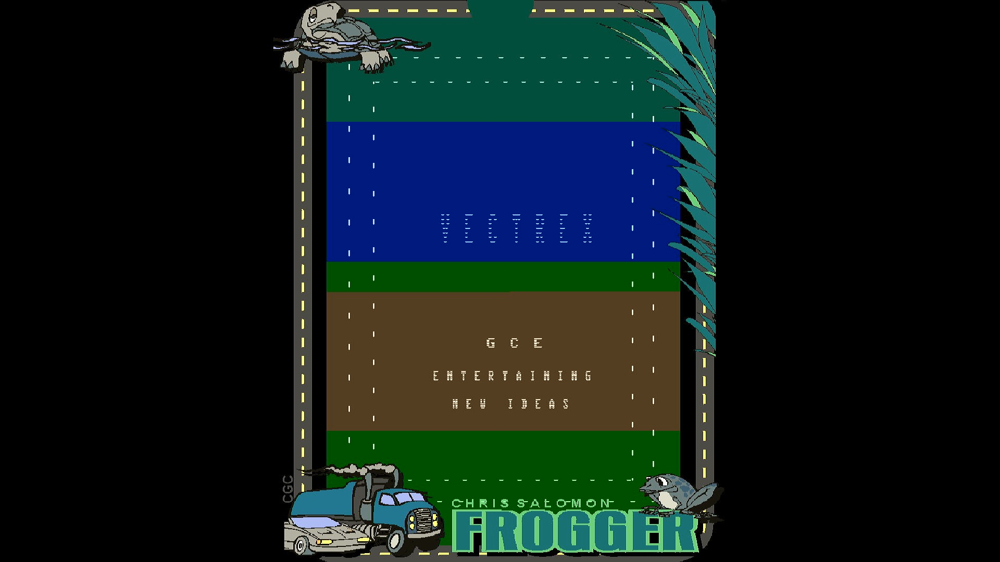

 

  

<h2 align="center">ps3vecx</h2>

  A PS3 Vectrex emulator based on <a href="https://github.com/jhawthorn/vecx">vecx</a>.

<h2>Installation & updating</h2>

Detailed information on installation, updating and troubleshooting can be found in the <a href="https://github.com/tbwcjw/ps3vecx/wiki">wiki</a>. <strong>DO NOT</strong> delete the application via the XMB, this will remove the directory containing all of your carts, overlays and roms. Instead, download the UPDATE_X.XX.zip file from releases, and extract it into the /dev_hdd0/game/PS3VECX01 directory.

<h2>Controls</h2>

<h3>Menu:</h3>

<ul>
  <li>D-Pad down/up - change section</li>
  <li>D-Pad left/right - change option</li>
  <li>X - interact</li>
</ul>

<h3>Emulator:</h3>

<ul>
  <li>D-Pad / L Joystick - up/down/left/right</li>
  <li>Start + Select - exit to menu</li>
  <li>Select - restart emulator</li>
  <li>Start - pause emulation</li>
  <li>L1 - fast forward/revert to normal speed</li>
  <li>Cross - button 1</li>
  <li>Square - button 2</li>
  <li>Triangle - button 3</li>
  <li>Circle - button 4</li>
</ul>

<h2>Configuration</h2>

This application creates config.txt in the USRDIR. This file is used as the go-between from the menu application to the emulator application. It shouldn't be modified manually, the menu should take care of that. There is nothing to stop you from editing it though, go mad and break stuff if you'd like.

<pre>
cart=about.vec          << the cartridge to load (optional)
rom=rom.dat             << the vectrex rom/bios (required)
overlay=                << the overlay to use (optional)
alpha=128               << the transparency of the overlay (0-255)
thickness=2             << the thickness of the lines drawn (1-5)
rotation=0              << the rotation of the screen (0 = normal, 1 = clockwise, 2 = counter-clockwise)
sync=1                  << vsync (0 = off, 1 = on)
gain=1.0                << audio gain (0.25 - 5.0)
pdecay=24               << phosphor decay (1 - 90)
</pre>

<h3>Attack of the flickering skeletons?</h3>

Adjusting the pdecay may help with any flickering/rolling you encounter

<h2>TODO</h2>

<ul>
  <li>Preview overlays in the menu</li>
  <li>Reconfigurable inputs</li>
  <li>Validate emulated sound (Spike voice lines!)</li>
  <li>Search for cart/overlay</li>
  <li>One button config file reset</li>
</ul>

<h2>DIY Vectrex Games</h2>

In making this I came across some good resources for vectrex 6809 processing. You can find some reference documents <a href="https://github.com/tbwcjw/ps3vecx/wiki/Resources">here</a>.

The applications "boot.vec", "about.vec", and "controls.vec" were all written using these resources.

<h2>Building</h2>

<h3>Requirements:</h3>

<ul>
  <li>PS3toolchain</li>
  <li>PSL1GHT</li>
  <li>PS3libraries w/ <a href="https://github.com/crystalct/tiny3D">tiny3d + libfont</a></li>
  <li>python2.7 (use pyenv)</li>
  <li>lwasm (if building vectrex carts)</li>
  <li>curl, <a href="https://github.com/aldostools/webman-mod">webMAN-MOD</a> (if uploading/installing pkg remotely)</li>
</ul>

The makefile within the root of the repository will build the entire project in one go. Alternatively, each part can built seperately with make -c EMU/MENU/VECTREXASM. The VERSION derives from APP_VER in MENU/sfo.xml

<h2>Screenshots</h2>

 
<i>Menu</i>

 
<i>Emulator w/overlay (Frogger)</i>

<h2>Authors</h2>

The base vecx emulator was forked from <a href="https://github.com/jhawthorn/vecx">https://github.com/jhawthorn/vecx</a>.

<ul>
  <li><a href="https://github.com/tbwcjw">tbwcjw</a> - PS3 port</li>
  <li>Valavan Manohararajah - vecx original author</li>
  <li><a href="https://twitter.com/jhawthorn">John Hawthorn</a> - vecx SDL port</li>
  <li><a href="https://twitter.com/nzeemin">Nikita Zimin</a> - vecx audio</li>
  <li><a href="https://twitter.com/simonkosua">Simon Rodriguez</a> - vecx SDL2 port</li>
  <li><a href="https://github.com/nothings/stb/blob/master/stb_image.h">stb_image.h</a> - MIT License Sean Barrett 2017</li>
</ul>

<h2>License</h2>

<ul>
  <li>This software is licensed under the <a href="LICENSE-MIT.md">MIT License</a>.</li>
  <li>The original vecx emulator is licensed under the <a href="LICENSE-GPL.md">GPL V3 License</a>.</li>
  <li>This application was created with the official non-official SDK called PSL1GHT, for more information visit <a href="http://www.psl1ght.com/">http://www.psl1ght.com/</a>. This is in no way associated with Sony Computer Entertainment Inc., please do not contact them for help, they will not be able to provide it.</li>
</ul>