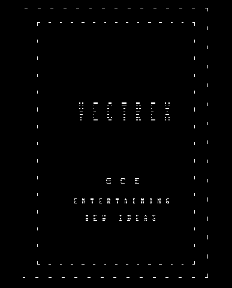
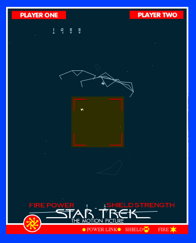

ps3vecX - Vectrex Emulator for the PS3
====

 

Controls
--------
Menu:

* D-Pad down/up change section
* D-Pad left/right change option
* X - change option value & select buttons

Emulator:

* D-Pad / L Joystick - up/down/left/right
* Start + Select - exit to menu
* Select - restart emulator
* Start - pause emulation
* L1 - fast forward
* Cross - button 1
* Square - button 2
* Triangle - button 3
* Circle - button 4

Updating
--------
**DO NOT** delete the application via the XMB, this will remove the directory containing all of your carts, overlays and roms. Instead, download the UPDATE_X.XX.zip file from releases, and extract it into the /dev_hdd0/game/PS3VECX01 directory.

Configuration
-------------
This application creates config.txt in the USRDIR. This file is used as the
go-between from the menu application to the emulator application. It shouldn't
be modified manually, the menu should take care of that. There is nothing to 
stop you from editing it though, go mad and break stuff if you'd like.

```
cart=about.vec          << the cartridge to load (optional)
rom=rom.dat             << the vectrex rom/bios (required)
overlay=                << the overlay to use (optional)
alpha=128               << the transparency of the overlay (0-255)
thickness=2             << the thickness of the lines drawn (1-5)
rotation=0              << the rotation of the screen (0 = normal, 1 = clockwise, 2 = counter-clockwise)
sync=1                  << vsync (0 = off, 1 = on)
gain=1.0                << audio gain (0.25 - 5.0)
pdecay=30               << phosphor decay (1 - 90)
```

**Attack of the flickering skeletons?**
Adjusting the pdecay may help with any flickering/rolling you encounter.


TODO
----
* Preview overlays in the menu
* Reconfigurable inputs
* Validate emulated sound (Spike voice lines!)
* Search for cart/overlay
* One button config file reset

Errors
------
* **Configuration file failed to parse**: There's something amiss about your config.txt file. Recreate it from the config.txt found in MENU/build/pkgfiles/USRDIR/config.txt.

* **Vectrex ROM (BIOS) was not found**: The rom.dat in USRDIR/rom is missing or corrupted. Redownload it from MENU/build/pkgfiles/USRDIR/rom/rom.dat

* **Failed to initialize audio thread**: The emulator failed to initialize the PPU thread for processing audio. Retry, or reboot the application, or reboot the system. (I'll work on it, honest)

* **Failed to initialize vecx emulator**: Probably a bug, usually comes from an audio thread/processing error.

* **Config file not found, creating it**: A bit of a non issue, recreates itself...

* **Failed to create a config file**: ...In theory. The system won't let us create a config.txt after not being able to find one. No sweat though; Recreate it from the config.txt found in MENU/build/pkgfiles/USRDIR/config.txt.

* **Failed to read one or more carts**: This could indicate a corrupted cartridge.

* **Failed to read one or more overlays**: Something about one of your overlays is incompatible or corrupted.

* **Failed to find the VECXEMU.SELF**: VECXEMU.SELF from USRDIR/ has gone missing. It can be redownloaded using an UPDATE_X.XX.zip found in releases.

* **Failed to find the VECXMENU.SELF**: Same as above, just for VECXMENU.SELF**.

* **Failed to find about.vec**: Not strictly necessary for anything, but can be redownloaded from VECTREXASM/about.vec

* **Failed to find controls.vec**: A little more necessary than the prior, if you want to know what the controls are, that is. Can be redownloaded from VECTREXASM/controls.vec

Some errors are showstoppers, and will exit the application. Other's are recoverable.

DIY Vectrex Games
-----------------
In making this I came across some good resources for vectrex 6809 processing. You can find some reference documents [here](RESOURCES.md).

The applications "boot.vec", "about.vec", and "controls.vec" were all written using these resources. Give it a try, don't let the vectrex die...

Building
--------
Requirements:

* PS3toolchain
* PSL1GHT
* PS3libraries w/ [tiny3d + libfont](https://github.com/crystalct/tiny3D)
* python2.7 (use pyenv)
* lwasm (if building vectrex carts)
* curl, [webMAN-MOD](https://github.com/aldostools/webman-mod) (if uploading/installing pkg remotely)

The makefile within the root of the repository will build the entire project in one go.
Alternatively, each part can built seperately with make -c EMU/MENU/VECTREXASM.
The VERSION derives from APP_VER in MENU/sfo.xml

Authors
-------
The base vecx emulator was forked from https://github.com/jhawthorn/vecx.

* [tbwcjw](https://github.com/tbwcjw) - PS3 port
* Valavan Manohararajah - vecx original author
* [John Hawthorn](https://twitter.com/jhawthorn) - vecx SDL port
* [Nikita Zimin](https://twitter.com/nzeemin) - vecx audio

Contributors
-------
* [Simon Rodriguez](https://twitter.com/simonkosua) - vecx SDL2 port

Credits
-------
[stb_image.h](https://github.com/nothings/stb/blob/master/stb_image.h) - MIT License Sean Barrett 2017

License
-------
* This software is licensed under the [MIT License](LICENSE-MIT.md).
* The original vecx emulator is licensed under the [GPL V3 License](LICENSE-GPL.md);
* This application was created with the official non-official SDK called PSL1GHT, for more information visit [http://www.psl1ght.com/](http://www.psl1ght.com/) . This is in no way associated with Sony Computer Entertainment Inc., please do not contact them for help, they will not be able to provide it.

...hey, that rhymed.